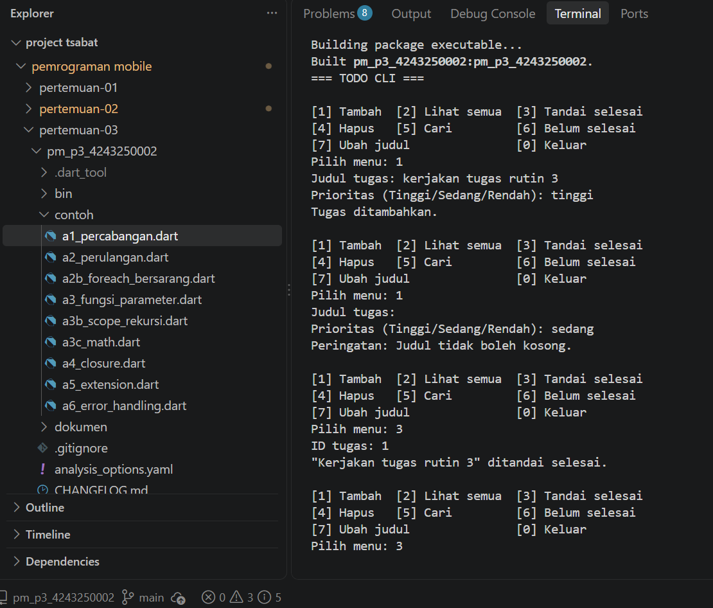
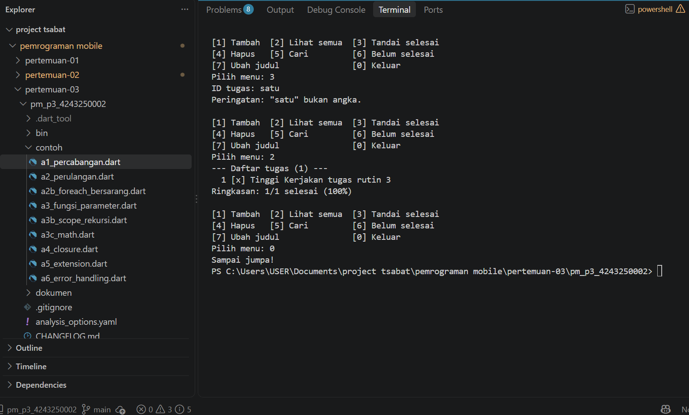

# Praktikum Pertemuan 3 — CLI Todo App

Pemrograman Mobile (3KOM40215) · Pertemuan 3 · Ilmu Komputer UNIMED

| | |
|---|---|
| Nama  | Muhammad Tsabat Muhyiyuddin |
| NIM   | 4243250002 |
| Kelas | PSIK24D |
| GitHub | [tsabat15](https://github.com/tsabat15) |

## Cara menjalankan

```
dart run                          # Todo CLI
dart run contoh/a4_closure.dart   # contoh dari Bagian A
```

## Isi repository

- `bin/pm_p3_4243250002.dart`: Todo CLI (Bagian B) dengan ketiga tantangan.
- `contoh/`: Contoh A.1 sampai A.6 dari modul.
- `dokumen/`: Lembar Kerja Praktikum (C) dan Latihan Mandiri (E).

## Tantangan yang dikerjakan

1. Menu **[7] Ubah judul** memakai `_indeksDari` dan menolak judul kosong.
2. **Prioritas** Tinggi/Sedang/Rendah pada record; tampilan diurutkan dengan `sort` dan fungsi pembanding.
3. Fungsi **`ringkasan()`** mengembalikan record `(total, selesai, persen)` dan ditampilkan di menu [2].

## Contoh keluaran

Judul kosong dan input huruf pada ID tidak menghentikan program:





Keluaran dari sesi uji yang lebih lengkap, termasuk ID yang tidak ada:

```
Pilih menu: ID tugas: Peringatan: "satu" bukan angka.
Pilih menu: ID tugas: "Kerjakan tugas rutin 3" ditandai selesai.
Pilih menu: --- Daftar tugas (2) ---
  1 [x] Tinggi Kerjakan tugas rutin 3
  2 [ ] Rendah Baca dokumentasi dart.dev
Ringkasan: 1/2 selesai (50%)
Pilih menu: ID tugas: Peringatan: Tugas dengan ID 99 tidak ditemukan.
Pilih menu: Sampai jumpa!
```

## Pernyataan penggunaan AI

Saya menggunakan asisten AI untuk membantu menyalin dan menguji kode modul, mengerjakan tantangan, dan menyusun README ini. Saya bertanggung jawab memahami seluruh isinya.
